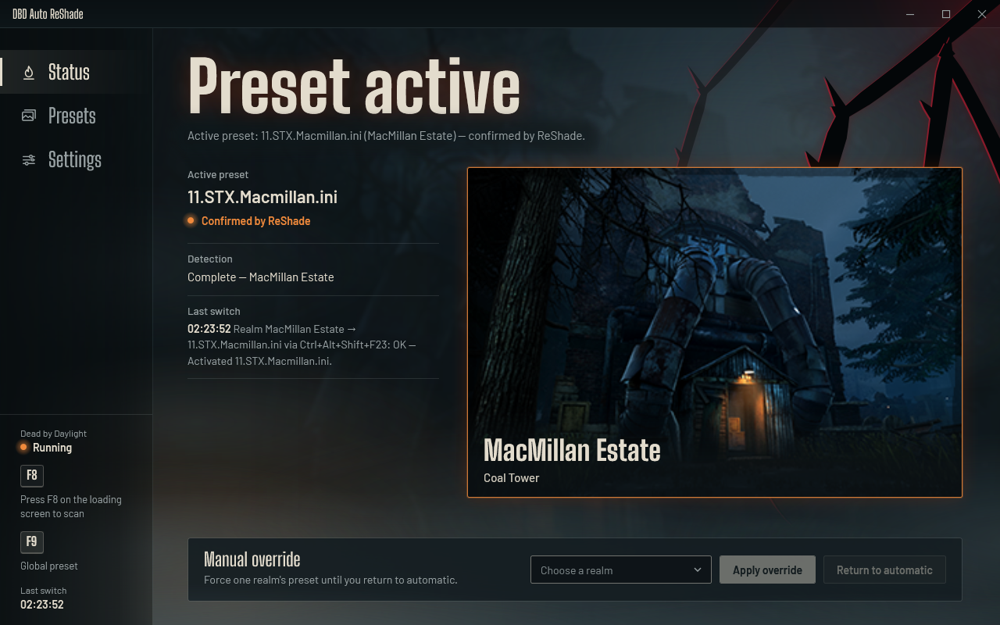
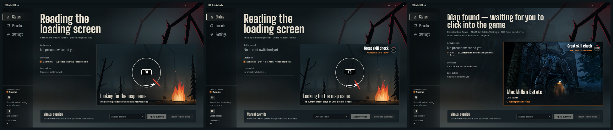
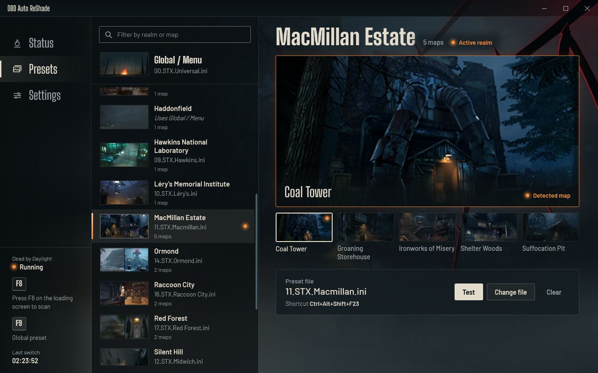
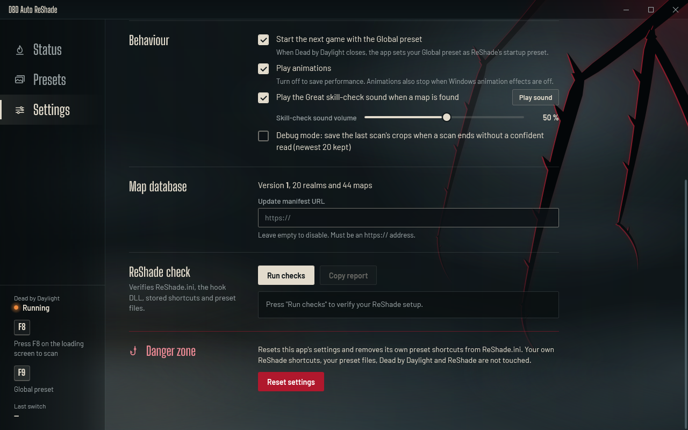

# DBD Auto ReShade

**Automatic per-map ReShade presets for Dead by Daylight.** Press **F8** on the loading
screen and the app reads the map name, works out the realm and switches ReShade to your
preset for it. When the match ends you're back on your Global/Menu preset.



- **Reads the map for you.** Local OCR reads the map and realm name off the loading screen.
  No templates, no setup per map, no internet.
- **One preset per realm.** All 20 realms and 44 maps are built in, each shown with its map
  pictures so you can tell them apart at a glance.
- **Hands-free switching.** The preset changes the moment the map is read, and ReShade
  confirms it. At the end of the match it goes back to Global.
- **F9 = Global, anytime.** A second hotkey switches straight back to your Global/Menu
  preset, even mid-match.
- **Dead by Daylight look and feel.** A foggy campfire window, the Entity watching from the
  corner, and a skill check that lands a **Great** (with the sound) when the map is found.
- **Light on your game.** Every animation pauses while you're playing, and **Play
  animations** turns them off completely.
- **Anti-cheat safe and offline.** No memory reading, injection, hooks or drivers. Nothing
  is ever uploaded.

## The skill check
While it scans, a skill check spins on the map plate. When the map is read, the needle lands in the great zone, the **Great**
sound plays and the map comes out of the fog.



## Presets
Pick a ReShade preset file for each realm. Every realm shows all of its maps, and the
filter box finds a realm by realm or map name ("coal", "lery", "swamp"…). Realms without
a preset use your **Global / Menu** preset.



## Install
1. Download `DBDAutoReShade-portable-win-x64.zip` from
   [Releases](https://github.com/SleepingNow/DBDAutoReShade/releases) and extract it
   anywhere. Keep the `Licenses` folder next to the exe.
2. Run `DBDAutoReShade.exe` as a normal user (not as admin).
3. The first-run setup asks for:
   - Dead by Daylight (found automatically when possible);
   - your `ReShade.ini`;
   - your Global/Menu preset;
   - the two hotkeys: **F8** to scan, **F9** for Global.

You need Windows 10/11 with the English OCR language pack. Windows usually has it; if not,
see [Troubleshooting](#troubleshooting).

## How to use
1. Start DBD Auto ReShade, then Dead by Daylight.
2. Assign a preset to each realm you care about under **Presets**.
3. On the loading screen, press **F8**. The skill check spins until the map is read, then
   lands a Great, and your realm's preset switches on.
4. Play. When the match ends, the app switches back to your Global preset.
5. Press **F9** whenever you want the Global preset right away.

A few things to know:
- DBD has to be the active window for a switch. If you were tabbed out, the app waits and
  switches as soon as you click back into the game.
- ReShade only loads new shortcuts when the game starts. After assigning a new preset while
  DBD is running, restart DBD once; the app tells you which presets are waiting for that.
- **Manual override** (bottom of the Status page) forces a realm's preset until you press
  **Return to automatic**, start a new scan, or close DBD.
- **Test** on the Presets page tries a preset in game: you get 15 seconds to click into DBD.

## Hotkeys
| Key | What it does |
| --- | --- |
| **F8** | Start scanning the loading screen. Press again to stop. |
| **F9** | Switch to your Global/Menu preset now. |

Both can be changed under **Settings**: F1–F24 on their own, or letters/numbers with
Ctrl, Alt or Shift. The Global hotkey can also be turned off with **Clear**.

## Settings


- **Restore the Global preset when a match ends.** On by default.
- **Play animations.** Turn off to save performance. Animations also stop on their own
  while the window isn't active, and when Windows animation effects are off.
- **Play the Great skill-check sound when a map is found**, with a **Play sound** preview.
- **Skill-check sound volume.** Starts at **50 %**.
- **Debug mode.** Saves the last scan's crops when a scan can't read the map, to help tune
  detection.
- **Paths**, **Map database updates** (optional HTTPS URL), **ReShade check** (a one-click
  setup report) and **Reset settings**.

## How the switching works
The app adds one shortcut per preset (`Ctrl+Alt+Shift+F13…F24`, then `…0–9`) to
`ReShade.ini` and presses it for you when a map is read. Your own ReShade shortcuts and
the rest of the file are left exactly as they are, and a backup
(`ReShade.ini.dbdautoreshade.bak`) is made on the first change. After each switch the app
checks that ReShade really changed preset.

Keep ReShade's **Force correct modifier keys** option on (ReShade's default).

## Troubleshooting
- **The map was read but the preset didn't change.** Read the status line on the Status
  page; it says exactly what's missing. Usually DBD wasn't the active window (click into
  the game), or ReShade still needs a game restart to load a new shortcut.
- **Test works but automatic switching doesn't.** It's a focus or timing issue: stay in
  the game window while the map is read.
- **Nothing happens when I press a key.** Run the game and the app the same way: both
  normally, not one of them as admin.
- **"Local OCR unavailable".** Install the English OCR pack: Windows Settings → Time &
  language → Language → English → Options → OCR. Press F8 again after about 10 seconds.
- **"Scan paused".** Another window is covering the map name. Click into the game.
- **F8 or F9 does nothing.** The keycap in the left rail is dimmed and a banner explains
  why (usually another program uses that key). Pick another key under Settings.
- **No Great sound.** Check the sound checkbox and the volume under Settings, then
  Windows' volume mixer.
- **Still stuck?** **Settings → ReShade check → Run checks** lists what's wrong with the
  setup.

## Privacy and anti-cheat
Everything runs on your PC. Screen captures, OCR text and decisions never leave the
machine, and there is no telemetry.

The app only enumerates processes (query-only access), captures the screen, reads text
with Windows' built-in OCR, edits `ReShade.ini`, registers hotkeys and sends keystrokes.

It never reads or writes game memory, injects, hooks, patches, uses drivers, sniffs
traffic or uses cloud OCR.

## Build from source
Requires the .NET 10 SDK on Windows.

```bash
dotnet build DBDAutoReShade.slnx -c Release
dotnet test tests/DBDAutoReShade.Tests/DBDAutoReShade.Tests.csproj -c Release
dotnet publish src/DBDAutoReShade.App -c Release -r win-x64 --self-contained true -p:PublishSingleFile=true -o publish/DBDAutoReShade
```

Ship the whole `publish/DBDAutoReShade` folder (the exe plus `Licenses\`) as
`DBDAutoReShade-portable-win-x64.zip`. Developer notes and the full change history are in
[PROGRESS.md](PROGRESS.md).

## Credits
DBD Auto ReShade is an unofficial fan tool. It is not affiliated with or endorsed by
Behaviour Interactive.
- **Map pictures:** Behaviour Interactive's in-game map icons from Dead by Daylight, via the
  [Dead by Daylight Wiki](https://deadbydaylight.wiki.gg). Dead by Daylight and its artwork
  are trademarks and copyright of Behaviour Interactive Inc.
- **Fonts:** [Barlow](https://github.com/jpt/barlow) and
  [Big Shoulders Display](https://github.com/xotypeco/big_shoulders), SIL Open Font
  License 1.1.
- **Great sound:** an original synthesized sound made for this app. It contains no audio
  from the game.
